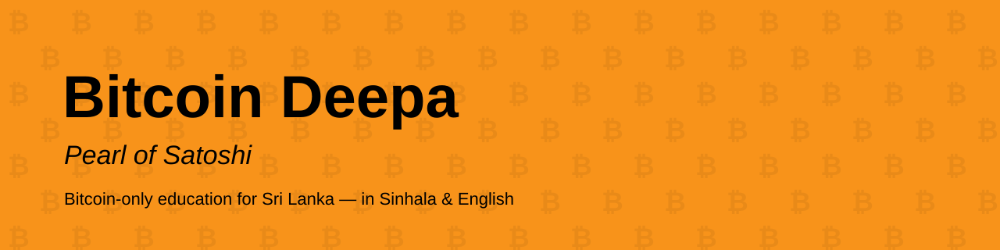

  

  
  
  
  
  

## Bitcoin Deepa · බිට්කොයින් දීප

**Bitcoin Deepa helps people in Sri Lanka understand and use Bitcoin, in Sinhala and English.**

We are a Bitcoin-only, non-profit education community — the *Pearl of Satoshi*. The name joins **Bitcoin**, the Sinhala word **දීප** ("island"), and the **Yaka** mask from Sri Lankan mask craft. We teach Bitcoin in plain words, keep Sinhala and English on equal footing, and build free, open tools so anyone on the island can learn and self-custody.

> *ශ්‍රී ලංකාවේ ජනතාවට බිට්කොයින් තේරුම් ගැනීමට සහ භාවිතා කිරීමට — සිංහලෙන් සහ ඉංග්‍රීසියෙන්.*

## What we build

- **Lightning wallet** — a Telegram-based Lightning wallet for everyday sats, running on our own LNbits + LND infrastructure.
- **DCA tool** — stack sats on a schedule.
- **Education** — a Sinhala Bitcoin book (ISBN 978-624-6580-00-1), workshops, and community sessions.
- **Bitcoin Deepa app** — a mobile app bringing the wallet, learning, and buy/sell together.

## Our code is open — by design

Everything we ship is **open source under [AGPL-3.0](https://www.gnu.org/licenses/agpl-3.0.html)**. As a non-profit, we want the code to stay free and auditable for the people who rely on it: anyone can read it, run it, learn from it, and improve it — and anyone who runs a modified version as a service must share their changes too.

The **code** is open. The **Bitcoin Deepa brand** — the name, "Pearl of Satoshi", the Yaka mask, the දීප glyph, and the logos — is a reserved trademark of CeylonCash and is *not* covered by the code licence. See [TRADEMARK](https://github.com/BitcoinDeepa/.github/blob/main/TRADEMARK.md) and the [brand guidelines](https://bitcoindeepa.com/brand).

## Contribute

New contributors are welcome, whether you write Sinhala docs, fix a bug, or run a node.

- 📋 [Contributing guide](https://github.com/BitcoinDeepa/.github/blob/main/CONTRIBUTING.md)
- 🤝 [Code of Conduct](https://github.com/BitcoinDeepa/.github/blob/main/CODE_OF_CONDUCT.md)
- 🔒 [Security policy](https://github.com/BitcoinDeepa/.github/blob/main/SECURITY.md)
- 💬 [Join the community on Telegram](https://t.me/BitcoinDeepa)

## Connect

[Website](https://bitcoindeepa.com) · [Telegram](https://t.me/BitcoinDeepa) · [Wallet bot](https://t.me/bitcoindeepabot) · [X](https://x.com/pearlofsatoshi) · [Instagram](https://instagram.com/bitcoindeepa) · [Blog](https://blog.bitcoindeepa.com) · [Events](https://lu.ma/bitcoindeepa) · [hello@bitcoindeepa.com](mailto:hello@bitcoindeepa.com)

A CeylonCash community initiative · Colombo, Sri Lanka 🇱🇰
